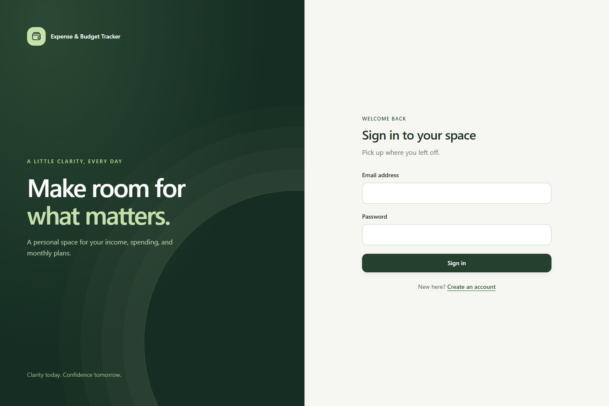
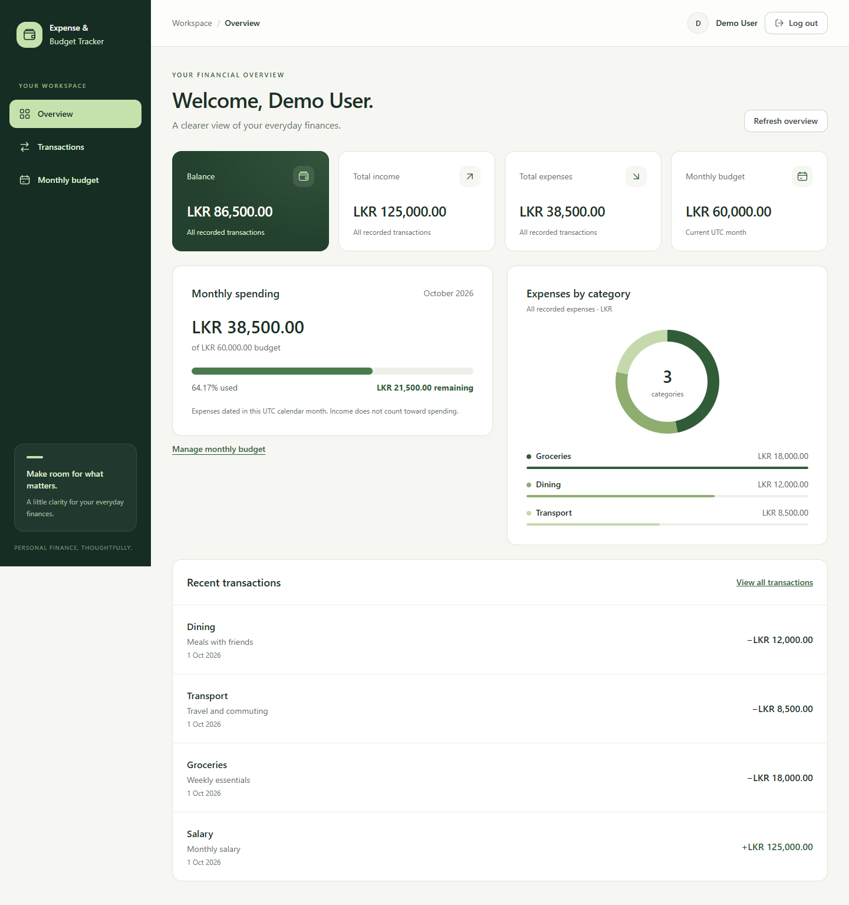
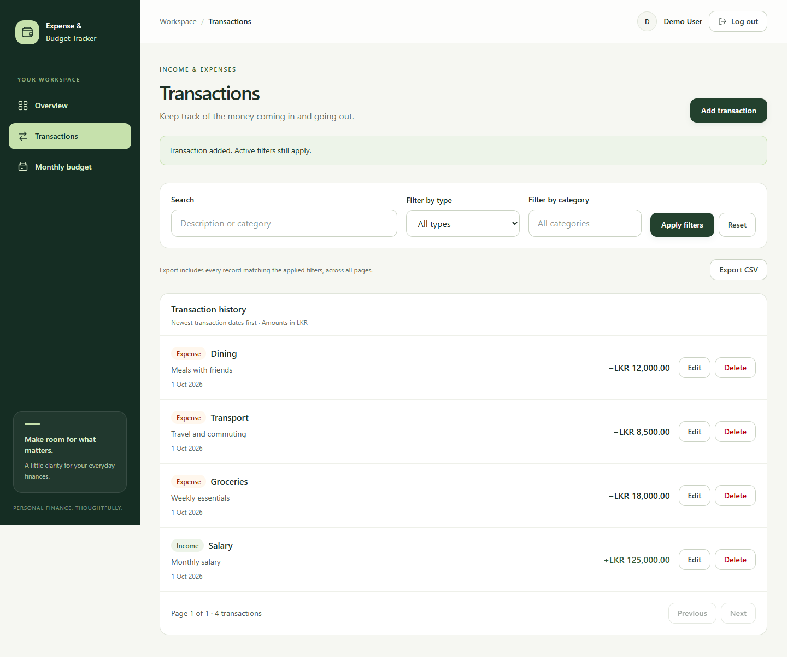
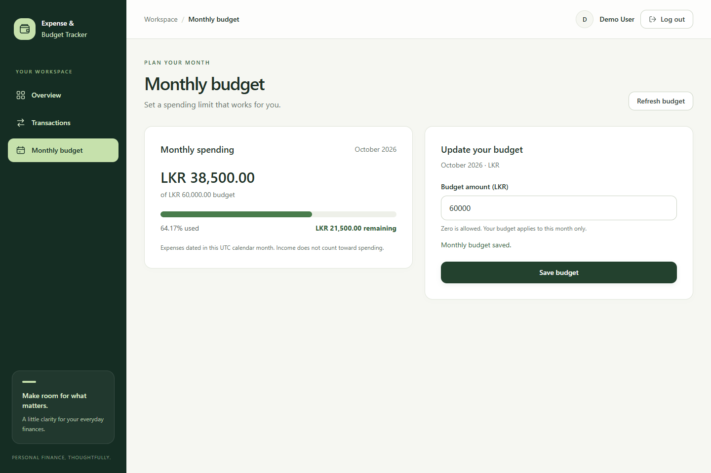

# Expense & Budget Tracker

A personal finance application by **Mohomad Mushrif**, developed as a university individual assignment across nine parts. Track income and expenses, plan a monthly budget, and understand spending in one responsive workspace.

## Features

- Registration, login, JWT authentication, protected pages, and logout.
- Create, view, edit, and delete your own income and expense transactions.
- Search descriptions/categories, combine type/category filters, and browse paginated results.
- Export all matching transactions to CSV, with spreadsheet formula protection.
- Set or update the current monthly budget, including zero budgets and overspending feedback.
- Dashboard with income, expenses, balance, recent activity, and an expense-category chart.
- Responsive ivory/green interface, keyboard focus, accessible form errors, reduced-motion support, and loading/error/retry states.

## Technologies

JavaScript, React, Vite, Tailwind CSS, React Router, native Fetch, Node.js, Express, MongoDB, Mongoose, bcryptjs, and jsonwebtoken. The chart uses CSS and actual API data; no chart library or external font service is required.

## Project structure

```text
frontend/
  src/
    components/ context/ hooks/ layouts/ pages/ services/ utils/
    App.jsx main.jsx index.css
  tests/
  .env.example package.json vite.config.js
backend/
  config/ controllers/ middleware/ models/ routes/ utils/ tests/
  .env.example app.js server.js package.json
docs/screenshots/
README.md
SUBMISSION.md
```

## Installation

Requires Node.js 22.12+ (Node 24 recommended), npm, and local MongoDB or an Atlas database. From the project root in PowerShell:

```powershell
npm.cmd ci --prefix backend
npm.cmd ci --prefix frontend
if (!(Test-Path backend/.env)) { Copy-Item backend/.env.example backend/.env }
if (!(Test-Path frontend/.env)) { Copy-Item frontend/.env.example frontend/.env }
```

### Environment variables

Configure `backend/.env`:

```dotenv
PORT=5000
MONGODB_URI=mongodb://127.0.0.1:27017/expense_budget_tracker
JWT_SECRET=
CLIENT_URL=http://localhost:5173
```

Generate a private secret and paste it into JWT_SECRET before starting the backend:

```powershell
node -e "console.log(require('node:crypto').randomBytes(48).toString('hex'))"
```

The secret must contain at least 32 characters. Keep it and any Atlas credentials only in your private environment file. For Atlas, replace MONGODB_URI and configure network/database access. Local MongoDB needs to be installed and running separately.

Configure `frontend/.env`:

```dotenv
VITE_API_URL=http://localhost:5000/api
```

VITE_ variables are public browser configuration: never place secrets in them. CLIENT_URL must match the frontend origin exactly, without a trailing slash. Restart servers after changing environment files.

## Running the application

Backend, from a terminal in the project root:

```powershell
cd backend
npm.cmd run dev
```

Frontend, from a second terminal in the project root:

```powershell
cd frontend
npm.cmd run dev
```

Open http://localhost:5173 and create an account. The backend starts listening only after MongoDB connects and required indexes initialize. `npm.cmd start` inside backend runs without watch mode.

### Build

```powershell
npm.cmd run build --prefix frontend
npm.cmd run preview --prefix frontend -- --port 5173
```

Stop the frontend development server before previewing on its port. Keep the backend running. A production host must serve the frontend with SPA route fallback and configure the correct API URL, HTTPS, and CORS origin.

## API overview

All routes except health, registration, and login require `Authorization: Bearer <token>`. Responses use `success`, `message`, and, where applicable, `data`. Ownership comes from the authenticated user, never a client-supplied user ID.

| Method | Endpoint | Purpose |
| --- | --- | --- |
| GET | /api/health | API liveness |
| POST | /api/auth/register | Create account and return token/user |
| POST | /api/auth/login | Authenticate and return token/user |
| GET | /api/auth/me | Current user |
| GET | /api/transactions | Filtered, paginated transactions |
| POST | /api/transactions | Create transaction |
| GET | /api/transactions/:id | Read owned transaction |
| PUT | /api/transactions/:id | Replace editable transaction fields |
| DELETE | /api/transactions/:id | Delete owned transaction |
| GET | /api/budgets/current | Current monthly budget and spending |
| PUT | /api/budgets/current | Create/update current budget |
| GET | /api/dashboard/summary | Totals, recent transactions, categories, budget |

Registration accepts name, email, password; login accepts email, password. Passwords require at least 8 characters at registration and at most 72 UTF-8 bytes. Emails are normalized and unique. JWTs expire after one day.

Transaction create/update accepts type (`income` or `expense`), positive numeric amount, category (1–100 characters), optional description (up to 1,000 characters), and date (`YYYY-MM-DD`). PUT requires the complete editable record. Category filtering is case-insensitive exact matching; search is a literal case-insensitive match in category/description. Query parameters: search, type, category, page (1–1,000,000), limit (1–100; default 10). List data contains `transactions` and `pagination: { page, limit, total, pages }`. Out-of-range pages clamp to the last available page.

Budget PUT accepts only `{ "amount": 60000 }`, with zero or more allowed. Budgets use the current **UTC calendar month**; only expenses dated within that month count. A missing budget differs from a saved zero budget. Overspending is shown explicitly; the visual progress bar caps at 100%. Dashboard totals/chart cover all recorded dates. Currency display is LKR, rounded to two decimal places.

Malformed JSON returns 400, bodies exceeding 10 KB return 413, invalid/expired authentication returns 401, and missing/unowned transactions return 404. Health is a liveness endpoint, not continuous database readiness.

## Verification

With MongoDB available and backend/.env configured, from the project root:

```powershell
npm.cmd test --prefix backend
npm.cmd test --prefix frontend
npm.cmd run build --prefix frontend
```

Backend tests use uniquely named temporary databases and remove only their own data. They need a database user with permission to create/drop test databases; use a development MongoDB instance.

Browser tests additionally require Microsoft Edge and Playwright. Install Playwright into a separate local tools folder if it is not already available:

```powershell
npm.cmd install --prefix "$env:LOCALAPPDATA/expense-tracker-test-tools" playwright
$env:PLAYWRIGHT_MODULE = "$env:LOCALAPPDATA/expense-tracker-test-tools/node_modules/playwright"
node frontend/tests/auth.browser.mjs
node frontend/tests/transactions.browser.mjs
node frontend/tests/dashboard.browser.mjs
node frontend/tests/pagination.browser.mjs
node frontend/tests/journey.browser.mjs
```

Run browser suites sequentially with port 5181 free. Each starts and stops its own temporary API/Vite servers and isolates database data. The journey suite regenerates the four README screenshots with synthetic demo data; no demo account is inserted into the application database. Other captures go to ignored frontend/.local/.

See [final verification results](FINAL-REVIEW.md) and the [demo script](DEMO-SCRIPT.md).

## Screenshots

Captured from the implemented application with isolated demo data.

### Sign in



### Dashboard



### Transactions



### Monthly budget



## Troubleshooting

- Database connection fails: start MongoDB and verify MONGODB_URI; for Atlas check access rules and credentials.
- Backend startup fails: check PORT, CLIENT_URL, JWT_SECRET, MongoDB availability, and unique indexes.
- Port occupied: stop the conflicting server or update PORT/VITE_API_URL together. Frontend port changes also require CLIENT_URL and Vite configuration changes.
- API/CORS failure: start both servers, use the configured frontend origin, and restart after environment changes.
- PowerShell blocks npm.ps1: use npm.cmd as documented.
- Git reports dubious ownership: for this known checkout, use `git -c safe.directory="D:/Gamage Projects/expense-budget-tracker" status` and the same per-command option for add/commit. No global Git configuration change is required.

## Security and limits

Passwords are hashed with bcrypt, JWT verification allows HS256 only, and protected data queries are scoped to the authenticated user. Error responses do not expose passwords, tokens, connection strings, or stack traces. Environment files, dependencies, build output, and local test artifacts are ignored by Git.

This assignment stores the JWT in localStorage, so preventing script injection remains essential. Logout removes the browser token but does not revoke an already copied token before expiry. There is no login rate limiting or password-reset flow. Deployments need additional operational hardening. CSV export detects some concurrent changes but does not provide a database snapshot. Monetary inputs are JavaScript numbers; displayed totals are rounded, not a full accounting ledger.

## Author and submission

**Mohomad Mushrif**

[Public GitHub repository](https://github.com/Mushrif-Unique/expense-budget-tracker)


